# Gainserv DevOps Practical

This repository contains my work for the Gainserv DevOps practical. I started with the provided Node.js application, packaged it in Docker, and pushed the image to Docker Hub so it can be deployed to Kubernetes.

I'm keeping the implementation and test evidence in this repository. The sections below cover the Docker work, Kubernetes and Terraform taks details.

## Application

The supplied Express application listens on port `3000` (or the `PORT` environment variable). I kept the application source unchanged.

| Endpoint | Purpose |
| --- | --- |
| `/` | Returns the service name and `status: ok` |
| `/healthz` | Health-check endpoint |
| `/compute?iterations=100000` | Runs a CPU-intensive calculation; useful for HPA load testing |

## Docker

I used a multi-stage Dockerfile with `node:22-alpine`. Dependencies are installed using the lockfile with `npm ci --omit=dev --ignore-scripts`, then copied into a smaller runtime stage. The container runs as the built-in `node` user (UID 1000), not root.

The image does not contain AWS credentials or other application secrets. Kubernetes-level controls such as a read-only root filesystem and disabling privilege escalation are configured separately in the deployment manifests.

### Build the image

From the project root:

```bash
docker build -f docker/Dockerfile -t gainserv-devops-app:v1 .
```

The build screenshot below shows the dependency installation stage. This screenshot is from the build output, not proof of the final build result; the subsequent container run and successful image push confirm that an image was produced.

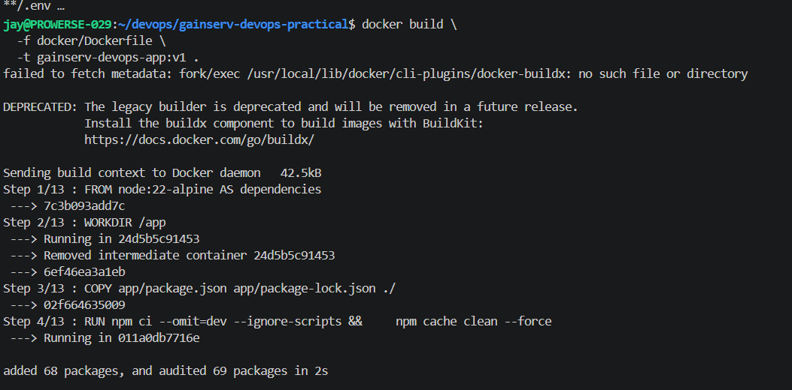

### Verify the container user

```bash
docker run --rm --entrypoint id gainserv-devops-app:v1
```

Output:

```text
uid=1000(node) gid=1000(node) groups=1000(node)
```

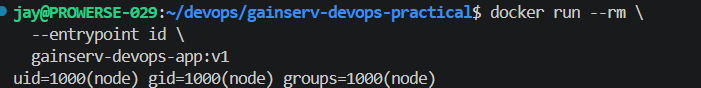

### Run locally

```bash
docker run -d --name gainserv-app -p 3000:3000 gainserv-devops-app:v1
docker ps
```

The container started successfully with host port `3000` mapped to container port `3000`.

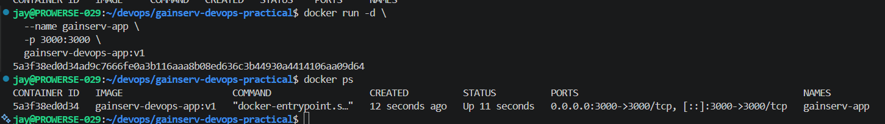

I also tested the three application endpoints locally:

```bash
curl http://localhost:3000/
curl http://localhost:3000/healthz
curl 'http://localhost:3000/compute?iterations=100000'
```

All three requests worked during local testing.

### Push to Docker Hub

I tagged and pushed the image to my public Docker Hub repository:

```bash
docker tag gainserv-devops-app:v1 jaykava/gainserv-devops-app:v1
docker push jaykava/gainserv-devops-app:v1
```

The push completed successfully and returned an image digest.

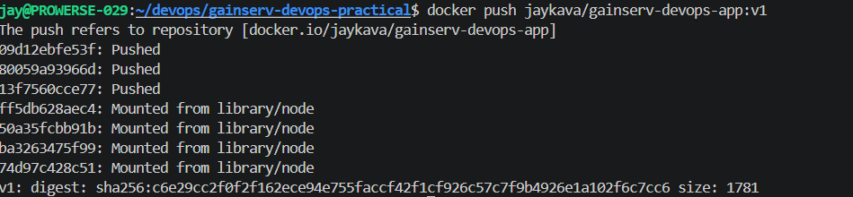

The `v1` image is also visible in Docker Hub:

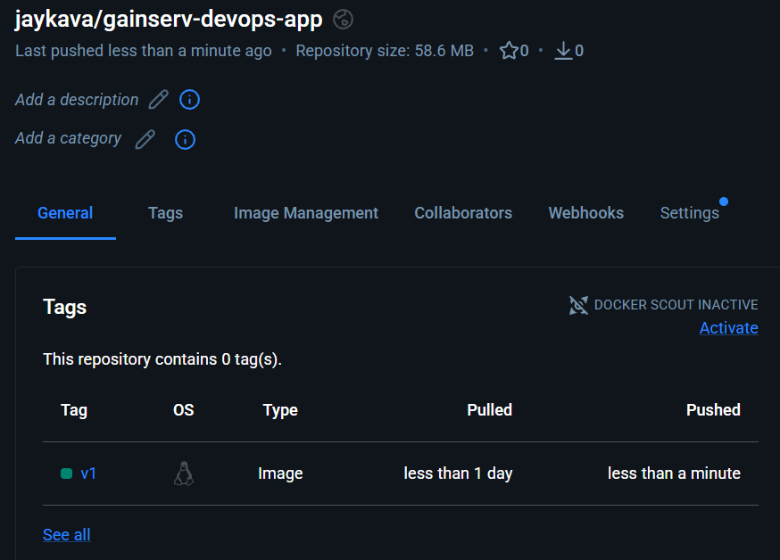

Image: [`jaykava/gainserv-devops-app:v1`](https://hub.docker.com/r/jaykava/gainserv-devops-app)

## Kubernetes

I used KillerCoda, which provides a ready-to-use Kubernetes cluster with control-plane (master) and worker nodes, eliminating the need to set up a cluster locally.

This environment allowed me to deploy the application and test HPA autoscaling, Pod security settings, ServiceAccount configuration, NetworkPolicy enforcement, and rolling deployments in a realistic Kubernetes environment.

### Cluster and deployment

The playground had two Ready nodes running Kubernetes v1.37.1. I cloned the project from GitHub and applied the manifests from the `k8s/` directory.

```bash
kubectl get nodes
git clone https://github.com/kava-jay/gainserv-devops-task-jay.git
cd gainserv-devops-task-jay
kubectl apply -f k8s/
kubectl get all -n gainserv
kubectl get networkpolicy -n gainserv
kubectl get pdb -n gainserv
```

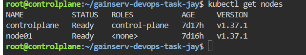
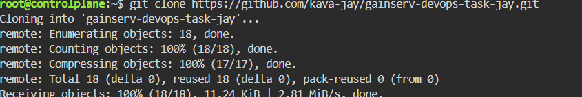
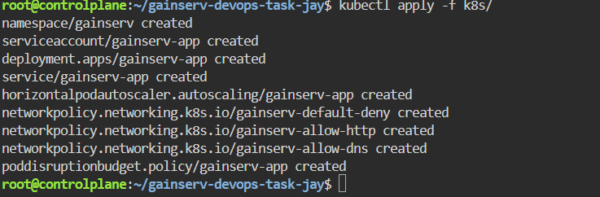

The initial deployment had two ready application Pods (`2/2`), a ClusterIP Service on port 80 forwarding to the application's port 3000, an HPA configured for 2–5 replicas, three application network policies, and a PodDisruptionBudget with `minAvailable: 1`.

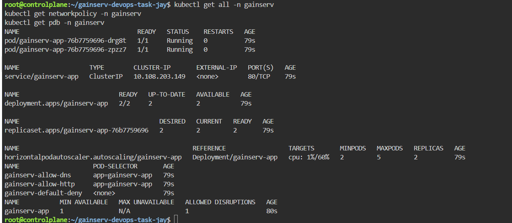

The Kubernetes files are organized as follows:

| File | What I configured |
| --- | --- |
| `k8s/00-namespace.yaml` | Dedicated `gainserv` namespace |
| `k8s/01-serviceaccount.yaml` | Dedicated ServiceAccount with automatic API token mounting disabled |
| `k8s/02-deployment.yaml` | Two replicas, rolling updates, probes, resource limits and security context |
| `k8s/03-service.yaml` | Internal ClusterIP Service |
| `k8s/04-hpa.yaml` | CPU-based HPA targeting 60%, minimum 2 and maximum 5 replicas |
| `k8s/05-networkpolicy.yaml` | Default-deny policy plus explicit HTTP and DNS allowances |
| `k8s/06-poddisruptionbudget.yaml` | At least one available replica during supported voluntary disruptions |
| `k8s/tests/` | Additional egress rules for the authorized test client; apply separately when testing |

The deployment uses `maxSurge: 1` and `maxUnavailable: 0`, plus readiness, liveness and startup probes on `/healthz`. Resource requests are 100m CPU and 64Mi memory per Pod; limits are 500m CPU and 128Mi memory. These are initial lab values, not a production load-test sizing recommendation.

### Application access and network isolation

I created an authorized BusyBox client with the label `access-gainserv=true`. Because the namespace uses default-deny egress, I also added test-only policies allowing that client to reach DNS and the application Pods on TCP 3000. Those test policies should live in `k8s/tests/` and be applied separately from the application manifests.

```bash
kubectl run allowed-client -n gainserv --image=busybox:1.36 \
  --labels='access-gainserv=true' --restart=Never --command -- sleep 3600
kubectl apply -f k8s/tests/
kubectl exec -n gainserv allowed-client -- wget -qO- -T 5 http://gainserv-app/
```

The authorized request returned:

```json
{"service":"gainserv-devops-practical","status":"ok"}
```

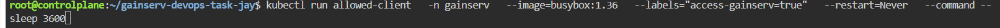
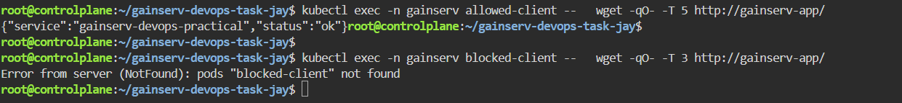

I tested restricted network access using the `blocked-client` Pod, which was unable to complete the request to the application Service. The NetworkPolicy is configured to allow ingress only from authorized Pods with the required labels, restricting access from unauthorized clients.

### Horizontal Pod Autoscaler

The HPA is configured with CPU utilization as the metric, a 60% target, and a range of 2–5 replicas. Metrics Server was available in the playground and the HPA reported valid CPU metrics before the test.

```bash
kubectl get hpa -n gainserv
kubectl top pods -n gainserv
```

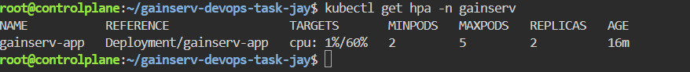

To generate CPU load, I used the provided `/compute` endpoint. I ran eight concurrent requests per batch from the authorized client for approximately four minutes:

```bash
kubectl exec -n gainserv allowed-client -- sh -c '
  end=$(( $(date +%s) + 240 ))
  while [ "$(date +%s)" -lt "$end" ]; do
    for i in 1 2 3 4 5 6 7 8; do
      wget -qO- -T 20 "http://gainserv-app/compute?iterations=20000000" >/dev/null &
    done
    wait
  done
'
```

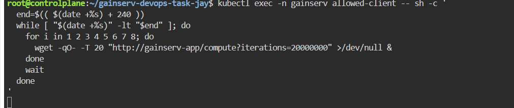

During the test, new application Pods were created and became Ready. HPA reached its configured maximum of **5 replicas**. CPU utilization reported by HPA peaked at approximately **246% of requested CPU** in the screenshots (against a 60% target). The application Pods were using roughly 231–257m CPU each at one sample point.

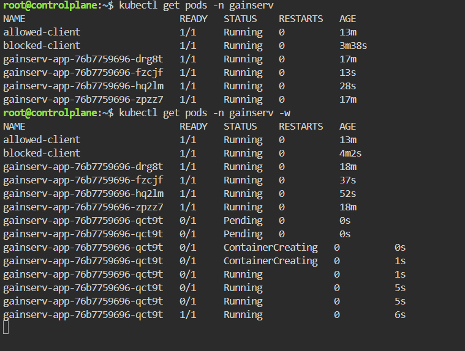
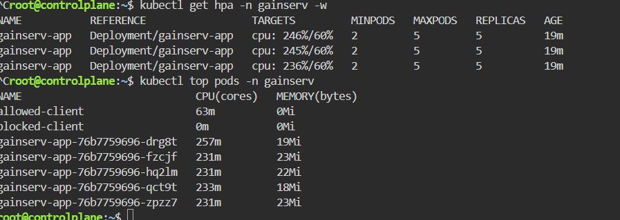

After the load stopped, CPU utilization dropped to about 1%. HPA reduced the replicas in stages from 5 to 4 to 3, and eventually back to the minimum of **2**.

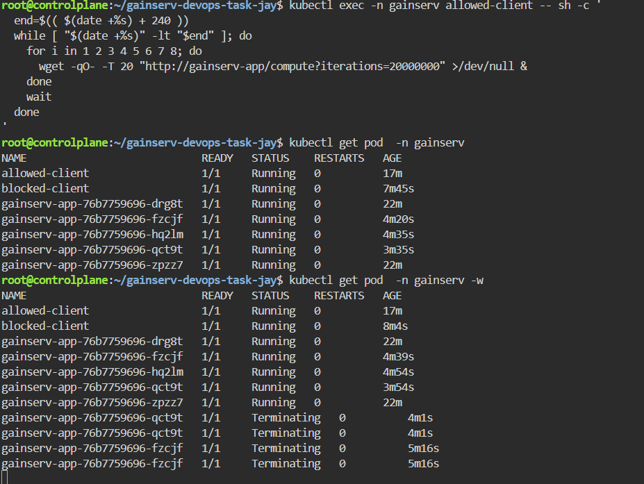
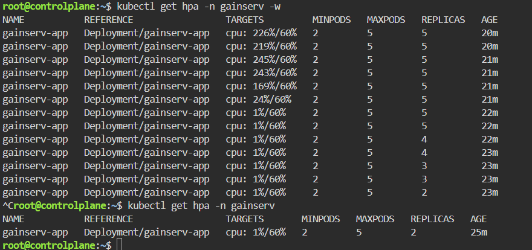
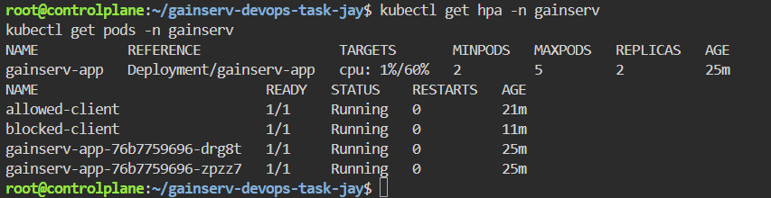
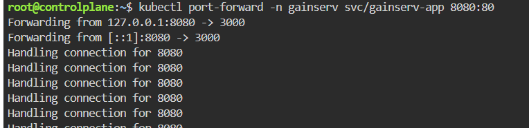

The HPA calculation is based on CPU usage relative to the CPU *request*, not the limit. For this app, the first likely bottleneck at much higher traffic is the synchronous CPU-bound work on Node.js's main event loop. HPA can spread requests across more Pods but cannot remove event-loop blocking within an individual process. On real EKS, node autoscaling is also needed if the cluster lacks capacity for the additional Pods.

### Rolling update and request availability

I tested a rollout restart while sending repeated requests to the ClusterIP Service from the authorized in-cluster client. I also used port-forwarding for local access, but I did **not** use port-forwarding as proof of availability during the rollout because its selected backing Pod may terminate.

```bash
kubectl exec -n gainserv allowed-client -- sh -c '
  i=1
  while [ "$i" -le 120 ]; do
    if wget -qO- -T 3 http://gainserv-app/ >/dev/null; then
      echo "Request $i: SUCCESS"
    else
      echo "Request $i: FAILED"
    fi
    i=$((i + 1))
    sleep 1
  done
'
```

In another terminal:

```bash
kubectl rollout restart deployment/gainserv-app -n gainserv
kubectl rollout status deployment/gainserv-app -n gainserv --timeout=180s
kubectl get pods -n gainserv -w
kubectl rollout history deployment/gainserv-app -n gainserv
```

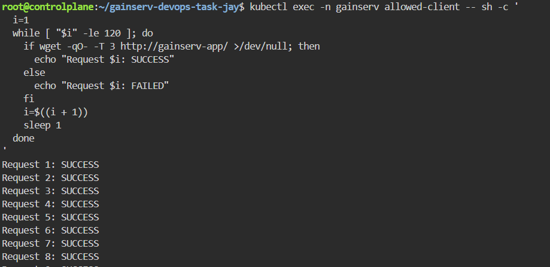
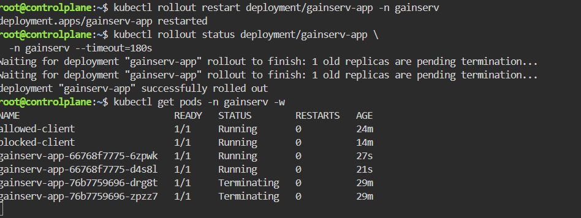
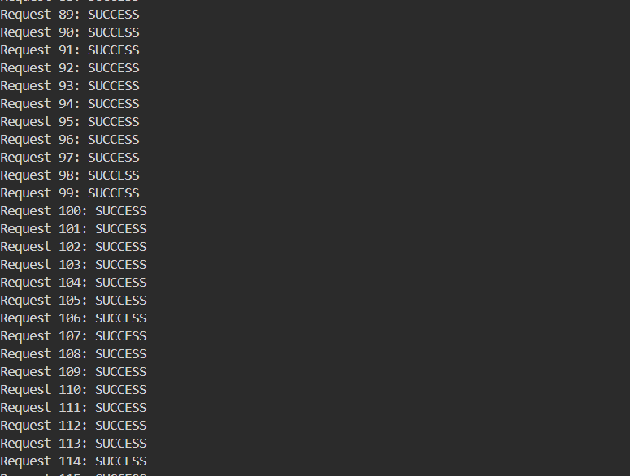
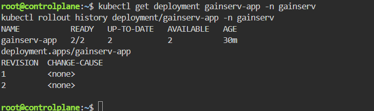
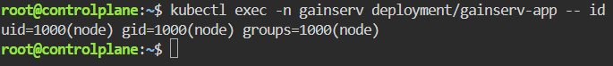

I performed a rolling deployment restart and tested application availability by sending continuous HTTP requests during the rollout. The rollout completed successfully, and the captured responses confirm that the application continued serving requests while old Pods were replaced with new ones. No request failures were observed in the captured samples, demonstrating minimal disruption during deployment.

### Container security

The Deployment runs the container with a non-root UID and a restricted security context. I checked the effective user from inside the running Pod:

```bash
kubectl exec -n gainserv deployment/gainserv-app -- id
```

Result:

```text
uid=1000(node) gid=1000(node) groups=1000(node)
```


The Deployment configuration also specifies `allowPrivilegeEscalation: false`, `readOnlyRootFilesystem: true`, `capabilities.drop: [ALL]`, and `seccompProfile: RuntimeDefault`. In a separate check I confirmed that writing to `/app` failed with `Read-only file system` and that the Kubernetes API token was not mounted. The ServiceAccount uses `automountServiceAccountToken: false`.

The PDB uses `minAvailable: 1`. This helps with supported voluntary disruptions but does not protect against every outage or guarantee zero disruption during a rolling update.


## Kubernetes security checks

After deploying the app, I checked the running Deployment and tested the security settings rather than relying only on the YAML files.

### Container security context

I checked the container-level settings with:

```bash
kubectl get deployment gainserv-app -n gainserv \
  -o jsonpath='{.spec.template.spec.containers[0].securityContext}'
```

The output confirmed `allowPrivilegeEscalation: false`, `readOnlyRootFilesystem: true`, and `capabilities.drop: ["ALL"]`. This limits privilege escalation, prevents writes to the container's root filesystem, and drops unnecessary Linux capabilities.

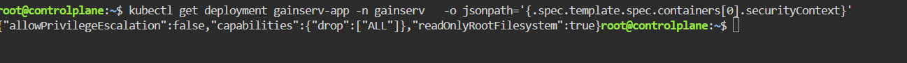

### Pod security context

I also checked the Pod-level settings:

```bash
kubectl get deployment gainserv-app -n gainserv \
  -o jsonpath='{.spec.template.spec.securityContext}'
```

The Deployment specifies `runAsNonRoot: true`, `runAsUser: 1000`, `runAsGroup: 1000`, and `seccompProfile.type: RuntimeDefault`. This configures the application to run as a non-root user and use the runtime's default seccomp profile.

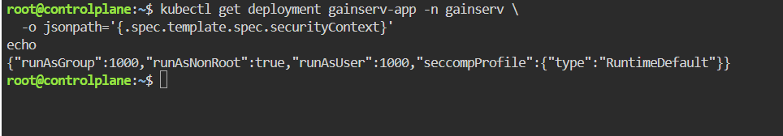

### Read-only filesystem test

To verify the filesystem restriction, I tried creating a file inside the application container:

```bash
kubectl exec -n gainserv deployment/gainserv-app -- \
  sh -c 'touch /app/security-test'
```

The command failed with `Read-only file system` and exit code 1. This is the expected result and confirms that the application directory cannot be modified at runtime.

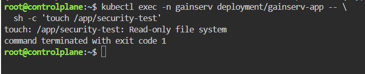

### ServiceAccount token mounting

I inspected the application's ServiceAccount and then checked whether a Kubernetes API token was mounted in the container:

```bash
kubectl get sa gainserv-app -n gainserv -o yaml

kubectl exec -n gainserv deployment/gainserv-app -- \
  sh -c 'test ! -f /var/run/secrets/kubernetes.io/serviceaccount/token && echo "PASS: No Kubernetes API token mounted"'
```

The ServiceAccount has `automountServiceAccountToken: false`, and the container test printed `PASS: No Kubernetes API token mounted`. The application does not need to call the Kubernetes API, so I disabled automatic token mounting to avoid exposing an unnecessary credential.

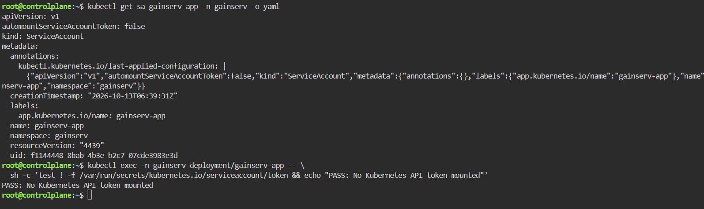

### Resource limits and PodDisruptionBudget

I checked the configured CPU and memory resources:

```bash
kubectl get deployment gainserv-app -n gainserv \
  -o jsonpath='{.spec.template.spec.containers[0].resources}'
```

Each app container requests `100m` CPU and `64Mi` memory, with limits of `500m` CPU and `128Mi` memory. These are initial lab values; production sizing should be reviewed against load-test measurements.

I also checked the PodDisruptionBudget:

```bash
kubectl get pdb -n gainserv
kubectl describe pdb gainserv-app -n gainserv
```

The PDB uses `minAvailable: 1`. With two healthy replicas, Kubernetes reported `Allowed disruptions: 1`, meaning one voluntary eviction could be permitted while retaining at least one healthy replica. This does not protect against every failure type or guarantee uninterrupted requests.

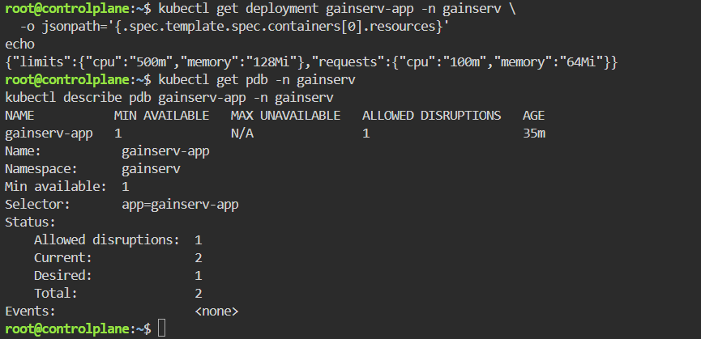


## Terraform — AWS infrastructure as code

I added Terraform configuration under `terraform/` to describe the AWS infrastructure supporting the application. I kept the configuration modular so networking, security groups, and workload IAM can be reviewed and reused independently. I validated the configuration locally; I did **not** provision AWS resources for this practical.

### Modules and infrastructure design

- **Network (`modules/network`)** — defines a VPC, private subnets across two Availability Zones, and their private route-table associations. The subnets have no default internet route in this example; a deployed EKS environment would need an explicit egress strategy, such as appropriate VPC endpoints or NAT.
- **Security groups (`modules/security-group`)** — a reusable module invoked with `for_each = local.security_groups` to define application and internal security groups from a map. The security group uses `create_before_destroy` and `name_prefix` to support replacement with less disruption, although this does not by itself guarantee zero downtime.
- **IAM (`modules/iam`)** — defines an optional IAM role for EKS Pod Identity with a trust policy scoped to the `gainserv` namespace and `gainserv-app` ServiceAccount. The example IAM policy limits S3 object reads to an application prefix. The current Node.js application does not need S3 access, so this is a demonstration of workload identity rather than a permission used by the running app.

At the root level, I used input-variable validation for environment and VPC CIDR settings, and `locals` for consistent resource names and tags. I configured `aws.primary` and `aws.secondary` provider aliases and explicitly passed the primary provider into child modules. The S3 backend is configured with encryption and DynamoDB locking as required by the exercise. Its bucket name is a placeholder, and the backend prerequisites have not been provisioned. DynamoDB locking is deprecated in newer Terraform versions; S3 native lockfiles are preferable for new configurations.

### Local initialization and validation

I used Terraform **v1.11.4** with the AWS provider **v5.100.0**. The screenshot also shows the `terraform fmt -check -recursive` command; the captured frame does not display its exit status.

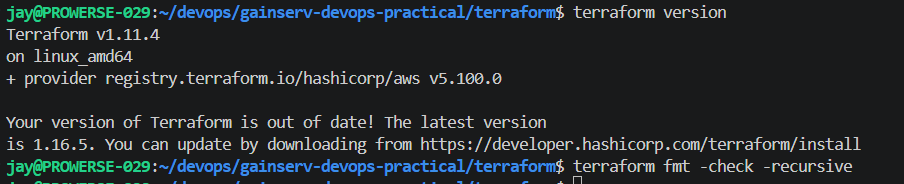

I initialized the Terraform working directory with `-backend=false` to install and resolve modules and providers without attempting to access the placeholder S3 backend. Terraform reported successful initialization.

```bash
cd terraform
terraform init -backend=false
```

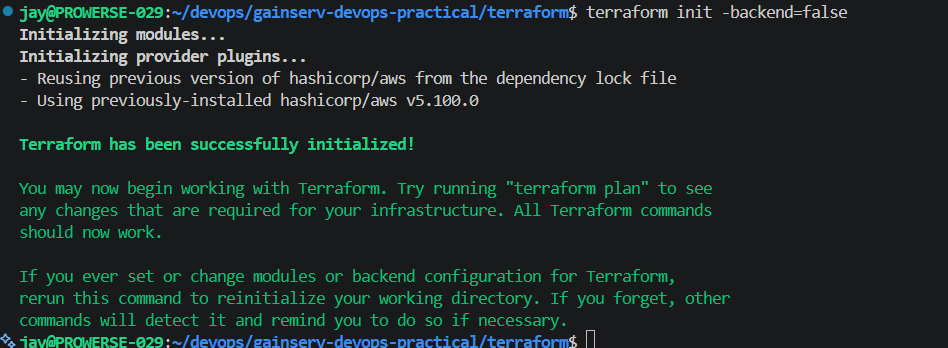

I ran recursive formatting and then validated the configuration. Terraform returned **`Success! The configuration is valid.`**

```bash
terraform fmt -recursive
terraform validate
terraform fmt -check -recursive
```

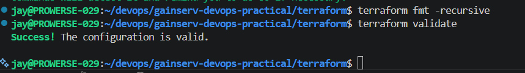

Finally, I inspected the root configuration to verify that both provider aliases and the module-level `for_each` were present. The output shows `primary` and `secondary` aliases, explicit `providers` mappings, and `for_each = local.security_groups`.

```bash
grep -nE 'alias|providers|for_each' providers.tf main.tf
```

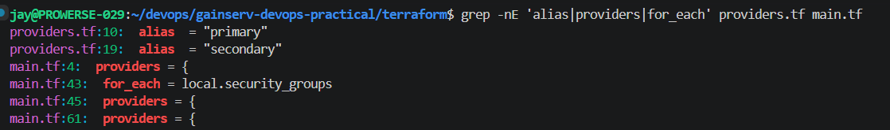

### Deployment scope

This exercise demonstrates the **Terraform configuration and local validation**, not a completed AWS deployment. I did not run `terraform apply`, create an EKS cluster, or verify an AWS Pod Identity association against a live cluster. The Kubernetes workload testing was performed separately in the lab environment. Before using this Terraform in AWS, I would provision the remote-state prerequisites, review network egress and IAM permissions, supply actual environment inputs, and run `terraform plan` against the target AWS account.


I've shared the Google Drive link below for your reference. Please have a look.
https://drive.google.com/file/d/1w6COJLKQlTygLf2aka1FhLB3vcJwaS6A/view?usp=sharing